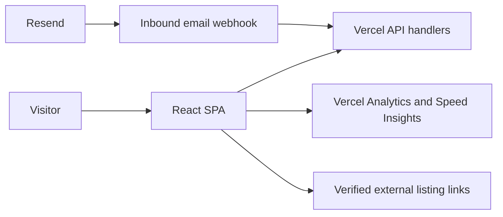

# Architecture Reference

## System Overview

The Druids Den is a React 19 single-page application built by Vite and
deployed with Vercel. Vercel serves the static client bundle, rewrites
non-API routes to the SPA entry point, and runs the small set of handlers under
`api/` as serverless functions.

The site has no first-party reservation, account, or application-database
service. Visitors find rental listings through verified external platform
links on `/stay`. Resend handles the inbound-email notification webhook, and
the Spooktoberfest page has its own passcode endpoint. Vercel Analytics and
Speed Insights provide site analytics.

## Client Routes

| Route | Access model | Purpose |
| --- | --- | --- |
| `/`, `/the-den`, `/what-to-expect`, `/gallery`, `/northwoods`, `/story`, `/stay`, `/traditions` | Public | Marketing, cabin, regional, rental, and traditions content. |
| `/guide` | Public implementation | General guest information only. It must not contain private details. |
| `/spooktoberfest` | Passcode gate | Event-specific content protected by a server-validated passcode flow. |
| `*` | Public | Redirects to `/`. |

`ProtectedRoute` owns the Spooktoberfest client gate. Its passcode is verified
by `/api/verify-passcode`; this event-only flow is not an account system.

The `/stay` page may link only to verified, property-specific HTTPS listing
URLs. The site does not accept reservations or provide first-party booking
availability.

## API Surface

| Endpoint | Methods | Purpose |
| --- | --- | --- |
| `/api/verify-passcode` | `POST` | Spooktoberfest passcode validation. |
| `/api/receive-email` | `POST` | Resend inbound-email notification forwarding. |

These endpoints do not use application accounts or a database. See
`docs/api.md` for request behavior and `docs/operations.md` for provider
configuration.

## External Services And Configuration

- Resend delivers inbound-email notifications to the configured owner inbox.
- The Spooktoberfest passcode is server-only configuration.
- Verified listing URLs and the WeatherAPI key are browser-visible Vite
  variables; they must contain no secrets or guest-private information.
- Vercel functions are configured with 1024 MB memory and a 10-second maximum
  duration in `vercel.json`.

Client `VITE_*` variables are exposed to the browser. Never put secrets,
guest-private data, or actual guide credentials in them. See
`content-and-privacy.md`.

## Security And Reliability Controls

- The passcode endpoint applies a per-instance, in-memory rate limit. This is
  best-effort protection and is not shared across Vercel instances or regions.
- The inbound-email handler validates configured webhook signatures and
  sanitizes logged/forwarded metadata.
- The public guide must not contain private arrival, access, Wi-Fi, or contact
  information.

## Validation Commands

| Change type | Required baseline check |
| --- | --- |
| Documentation only | `git diff --check` and link/reference review. |
| Client code or styles | `npm run lint`, `npm run test:run`, `npm run build`, then mobile and desktop visual inspection. |
| API behavior | `npm run lint`, relevant API tests, `npm run test:run`, and `npm run build`. |
| Privacy, metadata, or guide changes | Perform the content-and-privacy review in addition to the checks above. |

The available scripts are defined in `package.json`: `npm start`,
`npm run start:local`, `npm run dev`, `npm run build`, `npm run lint`, `npm test`,
`npm run test:run`, and `npm run test:ui`.
